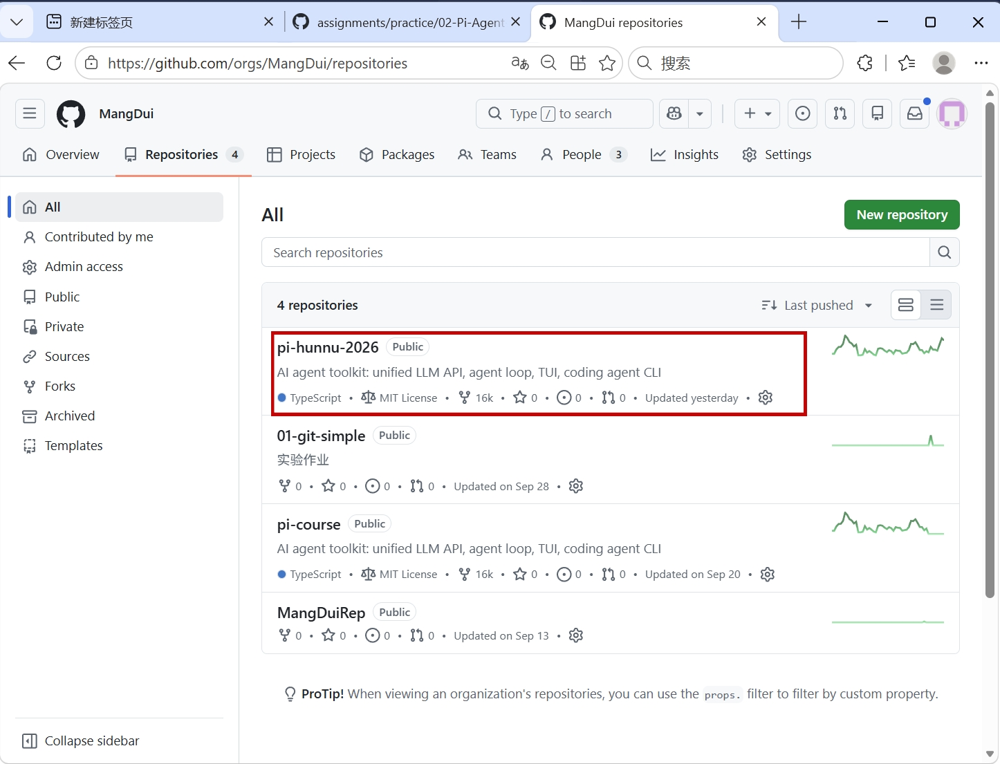
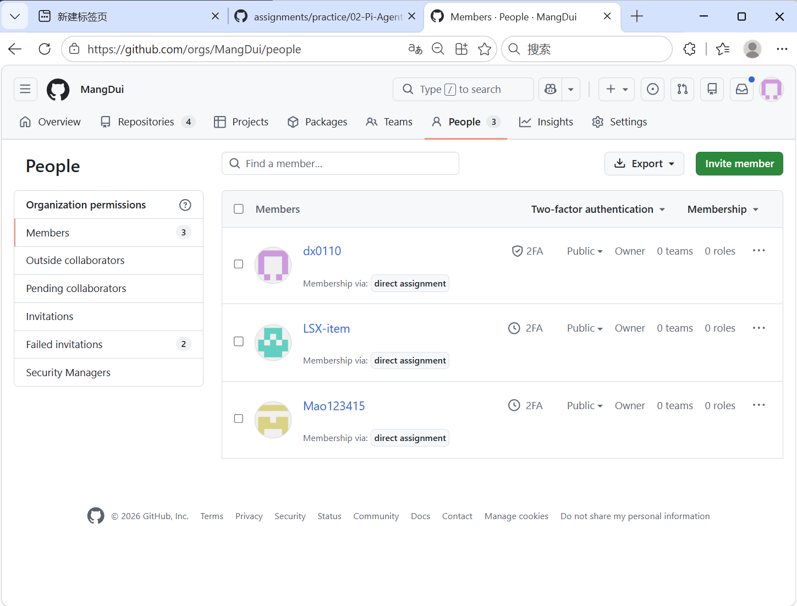
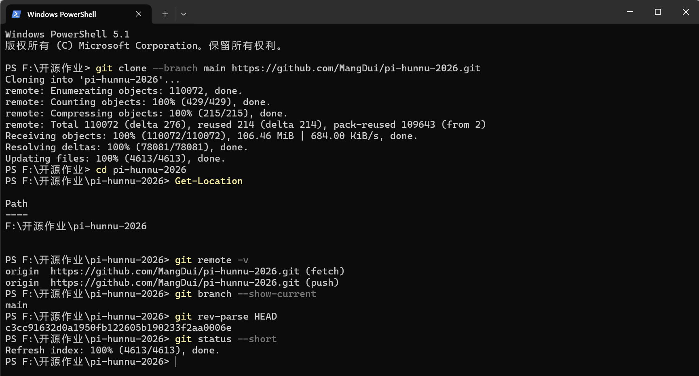
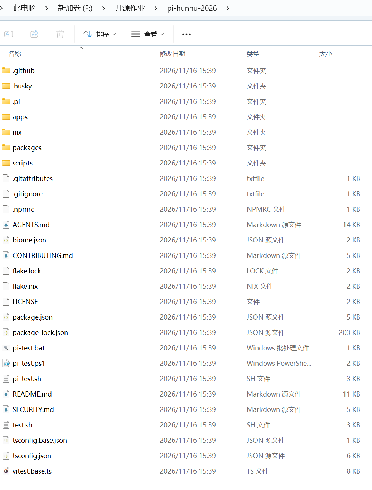
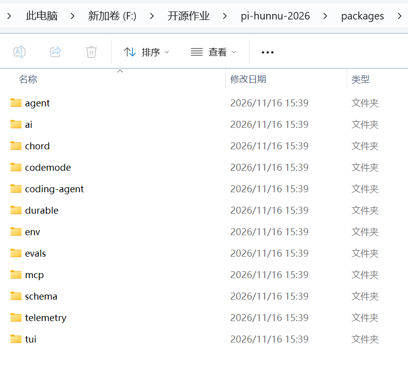
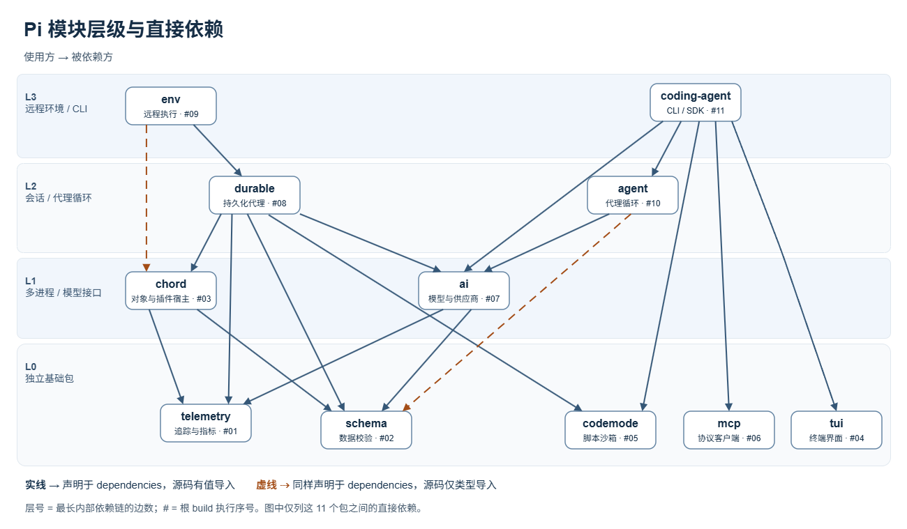

# 实践课 2 ： 组织建仓与 源码分析

## 基本信息与实验目标

- 姓名：邓鑫
- 学号：202430224057
- GitHub 用户名：[dx0110](https://github.com/dx0110)
- 个人仓库：[dx0110/02-Pi-Agent-fork](https://github.com/dx0110/02-Pi-Agent-fork)
- 组织仓库：[MangDui/pi-hunnu-2026](https://github.com/MangDui/pi-hunnu-2026)
- 提交编号：`c3cc91632d0a1950fb122605b190233f2aa0006e`

本次实验使用小组组织的 Pi fork，记录本地 clone 的版本，并根据该版本的代码分析模块功能和构建依赖。

**目录**

- [任务一 · 小组组织建仓](#task-1)
- [任务二 · 下载源码并确认版本](#task-2)
- [任务三 · 分析子模块功能与依赖关系](#task-3)
  - [构建顺序](#build-order)
  - [模块分析表](#module-table)
  - [模块层级与依赖关系图](#dependency-graph)
  - [直接依赖及其依据](#direct-dependencies)
  - [层级划分依据](#dependency-layers)
  - [三个问题的回答](#questions)

<a id="task-1"></a>

## 任务一 · 小组组织建仓

小组使用已经创建的 `MangDui/pi-hunnu-2026`。仓库 Owner 是小组组织 `MangDui`，保留了课程仓库的名称。组员统一从这个小组仓库获取源码。[小组 fork](https://github.com/MangDui/pi-hunnu-2026)


组织的 Repositories 页面列出了公开仓库 `pi-hunnu-2026`。下图红框标出本次实验使用的仓库。



组织的 People 页面显示三名成员，成员角色列显示为 Owner。



<a id="task-2"></a>

## 任务二 · 下载源码并确认版本

### 克隆命令

在 Windows PowerShell 中从小组组织的仓库 clone `main` 分支，并进入新建目录。

```powershell
git clone --branch main https://github.com/MangDui/pi-hunnu-2026.git
cd pi-hunnu-2026
```

### 本地仓库信息与 S1 截图

通过 `Get-Location` 确认本地目录为 `F:\开源作业\pi-hunnu-2026`，用 `git remote -v` 确认 `origin` 指向小组仓库。当前分支为 `main`，`git rev-parse HEAD` 输出完整***提交编号 c3cc91632d0a1950fb122605b190233f2aa0006e***，`git status --short` 未列出工作区变更。下方 S1 截图记录了 clone 过程和这些核对命令。



### 源码目录截图

pi-agent源码目录：



本地 `packages/` 目录包含作业所列的 11 个子模块，另外还有 `evals`。下图记录实际目录内容，`evals` 与根构建的关系在任务三说明。




<a id="task-3"></a>

## 任务三 · 分析子模块功能与依赖关系

分析依据是任务二记录的本地提交。本文对照各包的 `README.md`、`package.json`、编译配置和源码调用点，构建步骤与产物根据脚本推导。重点分析 `coding-agent`、`agent`、`ai` 和 `schema`，用一次工具参数校验串起四个模块的分工。

<a id="build-order"></a>

### 3.1 构建顺序

根目录的 `npm run build` 读取根 [`package.json`](https://github.com/MangDui/pi-hunnu-2026/blob/c3cc91632d0a1950fb122605b190233f2aa0006e/package.json) 中的 `scripts.build`。脚本逐次切换到各包目录，在每个目录运行该包自己的 `npm run build`。执行顺序如下，编号也用于图中：

```text
01 telemetry  02 schema  03 chord  04 tui  05 codemode  06 mcp
07 ai         08 durable 09 env   10 agent 11 coding-agent
```

当前 `packages/` 共有 12 个模块。题目所列的 11 个模块都在构建链中，额外的模块是 `evals`；其 [README](https://github.com/MangDui/pi-hunnu-2026/blob/c3cc91632d0a1950fb122605b190233f2aa0006e/packages/evals/README.md) 和 [package.json](https://github.com/MangDui/pi-hunnu-2026/blob/c3cc91632d0a1950fb122605b190233f2aa0006e/packages/evals/package.json) 显示，它用于行为评测，只通过 `devDependencies` 使用 `ai`、`coding-agent`，有评测和测试脚本，但没有 `build`，所以不进入本文构建图。根 `workspaces` 还包含 `apps/*` 及若干示例工作区，它们也不在这个根构建命令中。

<a id="module-table"></a>

### 3.2 模块分析表

表中的 `tsc` 指 `tsc -p tsconfig.build.json`，常规产物为本包 `dist/` 下的 JavaScript、类型声明及映射文件。每行的构建命令和依赖声明分别见对应包 `package.json` 的 `scripts.build` 和 `dependencies`。

| **子文件夹** | **代码主要实现什么功能** | **本模块 build 执行什么、生成什么** | **直接依赖哪些内部模块** | **依据文件或代码位置** |
| --- | --- | --- | --- | --- |
| `telemetry` | 定义跨进程追踪上下文和指标接口，提供空操作及内存记录实现。 | 运行 `tsc`，生成追踪契约、指标和内存实现等，如 `dist/index.js`、`dist/memory.js`。 | 无 | `packages/telemetry/src/index.ts` 的 `TelemetryContext`，`src/memory.ts:313`。 |
| `schema` | 构造 JSON Schema、推导值类型，并把规则编译成可复用的检查函数，支持转换和错误定位。 | 运行 `tsc`，生成构造器、验证器和独立格式入口，如 `dist/validator.js`、`dist/formats/index.js`。 | 无 | `packages/schema/src/builders.ts`，`src/validator.ts:14` 的 `compile`。 |
| `chord` | 按契约在不同进程托管对象、提供远程引用，管理文档、作业和插件重载。 | 运行 `tsc`，生成宿主及各子入口，如 `dist/node/http/`、`dist/node/plugins/`。 | `schema`、`telemetry` | `packages/chord/src/host/host.ts:537`，`src/data/validator.ts:3`，`src/context/index.ts:1`。 |
| `tui` | 提供终端输入和布局组件，通过主屏差量刷新与备用屏视口渲染界面。 | 运行 `tsc`，生成两种渲染器和组件，如 `dist/tui-main-screen.js`、`dist/tui-alt-screen.js`。原生组件另有构建脚本。 | 无 | `packages/tui/src/tui-main-screen.ts:269`，`src/tui-alt-screen.ts`。 |
| `codemode` | 在 QuickJS 的 WebAssembly 虚拟机中运行模型生成的脚本，并把工具请求转给宿主。 | 运行 `tsc`，生成 worker、可移植入口和 Cloudflare 入口，如 `dist/runtime/worker.js`、`dist/portable.js`。 | 无 | `packages/codemode/src/runtime/host.ts:20`，`src/runtime/vm.ts:160`。 |
| `mcp` | 实现 MCP 客户端的握手、工具发现和调用，支持标准输入输出及 Streamable HTTP。 | 运行 `tsc`，生成客户端、传输及 OAuth 代码，如 `dist/client.js`、`dist/oauth/index.js`。 | 无 | `packages/mcp/src/client.ts:221`、`src/client.ts:384`，`src/transports/`。 |
| `ai` | 统一模型目录、供应商认证和流式调用，处理用量、费用及工具参数校验。 | 联网生成模型目录的 TypeScript 包装和 JSON 数据，校验数据后运行 `tsc`，再刷新 `dist/providers/data/`。 | `schema`、`telemetry` | `packages/ai/catalog/generate.ts`，`scripts/check-model-data.ts`，`src/models.ts:958`，`src/utils/validation.ts:1`，`src/telemetry.ts:10`。 |
| `durable` | 持久化代理会话、模型轮次和工具任务，重新打开会话后恢复未完成工作。 | 运行 `tsc`，生成会话、调度、存储和执行环境接口，如 `dist/session/session.js`、`dist/harness/scheduler.js`。 | `chord`、`ai`、`codemode`、`schema`、`telemetry` | `packages/durable/src/session/session.ts`，`src/harness/scheduler.ts:477`，`src/harness/tool.ts:14`，`src/codemode/codemode.ts`。 |
| `env` | 将文件、命令和终端操作交给远端守护进程，并通过 SSH 探测、部署和启动该进程。 | 运行 `tsc`，生成客户端代码，如 `dist/remote-env.js`、`dist/ssh.js`。Rust 守护进程由 `build:daemon` 单独构建。 | `durable`、`chord`（仅类型导入） | `packages/env/src/remote-env.ts:5`、`src/remote-env.ts:354`，`src/ssh.ts:408`，`daemon/src/main.rs`。 |
| `agent` | 管理代理状态，按模型输出调度工具、发出事件，并把工具结果带回下一轮。 | 运行 `tsc`，生成 `dist/agent.js`、`dist/agent-loop.js` 等，编译配置引用 AI 包的已生成声明。 | `ai`、`schema`（仅类型导入） | `packages/agent/src/agent-loop.ts:172`、`src/agent-loop.ts:736`，`src/types.ts:17`，`tsconfig.build.json`。 |
| `coding-agent` | 组装 Pi CLI 和 SDK，提供编程工具、会话、扩展及交互、打印和 RPC 模式。 | `build:unbundled` 运行 `tsc`、设置入口执行权限并复制资源。随后 esbuild 生成 `dist/bundle/` 下的 CLI、共享代码块和 worker 等产物。 | `agent`、`ai`、`codemode`、`mcp`、`tui` | `packages/coding-agent/src/main.ts:1015`，`src/core/sdk.ts:403`，根目录 `scripts/build-coding-agent-bundle.mjs`。 |

<a id="dependency-graph"></a>

### 3.3 模块层级与依赖关系图

[编辑图源（draw.io）](../images/模块依赖图.drawio)

箭头统一从**使用方指向被依赖方**。图中从上到下按依赖深度分为四层，节点上的编号对应根构建顺序。



<a id="direct-dependencies"></a>

#### 3.3.1 直接依赖及其依据

图中的 18 条边都由各包 `package.json` 的 `dependencies` 声明，并能在源码中找到对应导入。每个包的直接依赖见[模块分析表](#module-table)的第四列，源码位置见第五列。

- **实线**表示源码存在值导入。例如 `chord → schema` 对应 `packages/chord/src/data/validator.ts:3` 对 `compile` 的导入。
- **虚线**表示该包的源码只导入类型。两条边分别是 `agent → schema`（`packages/agent/src/types.ts:17`）和 `env → chord`（`packages/env/src/remote-env.ts:5`）。
- **图的范围**是根构建链中的 11 个内部包。`evals` 对 `ai`、`coding-agent` 的开发依赖以及 Chord 的外部可选同伴依赖均在图的范围之外。

<a id="dependency-layers"></a>

#### 3.3.2 层级划分依据

层号等于该模块出发的最长内部直接依赖链的边数。没有内部依赖的包属于 L0，其余包的层号等于其所有直接依赖中的最高层号加一。因此箭头可以跨层，且总是指向较低的一层。

| 层级 | 模块 | 划分依据 |
| --- | --- | --- |
| L0 | `telemetry`、`schema`、`tui`、`codemode`、`mcp` | 无内部依赖。 |
| L1 | `chord`、`ai` | 最高的直接依赖在 L0，例如 `ai → schema`。 |
| L2 | `durable`、`agent` | 都依赖 L1 的 `ai`，`durable` 也依赖 L1 的 `chord`。 |
| L3 | `env`、`coding-agent` | 分别依赖 L2 的 `durable` 和 `agent`。 |

<a id="questions"></a>

### 3.4 三个问题的回答

#### 问题一 · 根目录与子模块的构建分别读取什么配置、执行什么工作？

**根目录。** npm 读取根 `package.json` 的 `scripts.build`，按[构建顺序](#build-order)进入各子目录，逐个运行各包的 `npm run build`。各步通过 `&&` 串联，任一步失败就停止。

**子模块。** npm 读取当前包 `package.json` 的 `scripts.build`。有九个包直接执行 `tsc -p tsconfig.build.json`；`ai` 和 `coding-agent` 也执行同一个编译命令，但还有前后步骤。这些 `tsconfig.build.json` 都继承根 [`tsconfig.base.json`](https://github.com/MangDui/pi-hunnu-2026/blob/c3cc91632d0a1950fb122605b190233f2aa0006e/tsconfig.base.json)，以本包 `src/` 为源码根、`dist/` 为输出目录。共享配置使用 ES2024，并启用声明和映射；常见产物是 `.js`、`.d.ts`、`.js.map`、`.d.ts.map`。包之间仍可通过各自的包入口导入；`tsc` 在这里不是打包器。

根 [`tsconfig.json`](https://github.com/MangDui/pi-hunnu-2026/blob/c3cc91632d0a1950fb122605b190233f2aa0006e/tsconfig.json) 另有用途：它配置 `noEmit: true`，且把许多包名映射到工作区源码，供根检查覆盖仓库源码和测试。子包构建并不继承它：例如 `agent/tsconfig.build.json` 把 AI 入口指向 `../ai/dist/index.d.ts`。一般的 `build` 也不会先运行各包的 `clean` 或测试。

对 `ai` 和 `coding-agent`，编译还分别与模型数据生成、CLI 打包串联。其执行顺序和产物见[模块分析表](#module-table)。

#### 问题二 · 构建顺序和模块依赖有什么关系？相邻模块是否一定互相依赖？

构建顺序解决的是“先有被依赖方的产物，再构建使用方”。例如 `ai` 先生成 `dist/index.d.ts`，`agent` 才能通过它的构建路径解析 AI 接口；最终打包 CLI 还要读取相关包的已编译 JavaScript。这 18 条边在当前根脚本中都满足先构建被依赖方。脚本采用的是一种满足依赖约束的**固定顺序**，可以在不同层之间穿插没有顺序约束的模块，例如先构建 L1 的 `chord`，再构建 L0 的 `tui`。

相邻构建不表示存在依赖。例如 `tui` 随后是 `codemode`，两者均无内部依赖；`env` 之后是 `agent`，两者之间也没有依赖。依赖还可以隔着多步，例如最后构建的 `coding-agent` 直接依赖第四步构建的 `tui`。

#### 问题三 · 一条涉及至少三个模块的依赖路径如何分工？

**依赖路径**　`coding-agent → agent → ai → schema`

以模型请求调用一个声明了数字参数 `count` 的工具、但生成了字符串 `"42"` 为例：

1. **`coding-agent` 组装会话。** `packages/coding-agent/src/core/sdk.ts:403` 创建 `Agent`，将模型、消息和工具装入运行配置。工具最后在哪里执行、结果怎样展示，分别由配置与会话模式决定。
2. **`agent` 调度下一步。** `packages/agent/src/agent-loop.ts` 取得助手消息后识别工具调用。准备执行时，先调用从 AI 包导入的 `validateToolArguments`（第 736 行），再把校验后的参数传给工具的 `execute`（第 835 行）。
3. **`ai` 适配模型输出。** `packages/ai/src/utils/validation.ts` 从工具定义取出 JSON Schema，缓存编译好的验证器，调用它解析模型生成的实参；失败时将错误路径整理成模型可读的消息。
4. **`schema` 提供转换和校验规则。** `packages/schema/src/validator.ts` 中的 `CoercingValidator.parse` 先转换输入再检查。对于上面的数字参数，验证通过时工具收到数字 `42`；若转换后仍不符合约束，验证报错，该次工具调用不会携带无效参数执行。

这条路径解释了为什么工具业务逻辑不必自己处理模型生成的松散参数：应用层注册工具，代理层安排调用，模型接口层适配参数，Schema 层负责执行规则。图还保留了其他真实直连，例如 `coding-agent → ai` 用于模型管理，`agent → schema` 用于静态类型推导。

### 3.5 逐模块阅读记录

<details>

<summary>展开 11 个模块的源码与构建分析</summary>

##### 01. `telemetry`：跟踪和指标的公共接口

- **功能：** `TelemetryContext` 显式传递追踪上下文。`span` 表示一次有起止的操作，可记录属性、事件和状态，还能通过载体传播上下文；指标端提供计数器和直方图。包自带空操作实现和可查询记录的内存实现，调用方可接自己的后端。
- **构建：** 标准编译；输出契约、指标、内存实现和测试辅助入口等，例如 `dist/index.js`、`dist/memory.js` 和 `dist/testing/index.js` 及声明。不会生成后端或启动导出服务。
- **直接依赖：** 无内部包。
- **依据：** `packages/telemetry/{README.md,package.json,tsconfig.build.json}`；`src/index.ts` 的 `TelemetryContext`、`defineTelemetrySchema`，`src/metrics.ts` 的 `createTypedMetrics`，`src/memory.ts:313` 的 `InMemoryTelemetryContext`。

##### 02. `schema`：JSON Schema 构造、类型推导和校验

- **功能：** `obj`、`str` 等构造器生成 JSON Schema，并可用 `Static` 推导 TypeScript 值类型。`compile` 将规则编译成普通函数，可检查值、按 JSON Pointer 报告错误；开启 `coerce` 后也可先转换再校验，例如把合法数字字符串转换成数字。
- **构建：** 标准编译，输出 `dist/index.js`、验证器及独立的 `dist/formats/index.js` 等。`compile` 编译具体 Schema 是库被调用时的行为。
- **直接依赖：** 无内部包。
- **依据：** `packages/schema/{README.md,package.json,tsconfig.build.json}`；`src/builders.ts`、`src/validator.ts:14` 的 `compile`、`src/compiler.ts` 与 `src/formats/index.ts`。

##### 03. `chord`：跨进程对象、状态和插件宿主

- **功能：** 用契约描述对象的参数、方法和状态；宿主按契约加载插件在该宿主上的声明，并通过链接向本地或远程调用者提供对象引用。包还提供文档事务、存储、作业和插件重载等功能。插件自己的构建可以调用 esbuild，这是 Chord 被应用调用时的行为。
- **构建：** 标准编译，输出主入口以及 `dist/node/http/`、`dist/node/plugins/`、`dist/react/` 等子入口和声明。
- **直接依赖：** `schema`（`src/contracts/schema.ts:21` 使用构造器，`src/data/validator.ts:3` 导入 `compile`）；`telemetry`（`src/context/index.ts:1` 导入默认空上下文）。`esbuild`、`react`、`ws` 是外部可选同伴依赖，即按具体入口需要由应用侧提供。
- **依据：** `packages/chord/{README.md,package.json,tsconfig.build.json}`；`src/host/host.ts:537` 的 `createHost`，`src/documents/`、`src/store/` 及 `src/node/plugins/build.ts:87` 的 `buildFacet`。

##### 04. `tui`：终端组件与差量渲染

- **功能：** 提供输入框、编辑器、Markdown、布局等界面组件。主屏渲染器比较新旧行，备用屏渲染器管理可滚动视口；两者使用终端同步输出控制序列，减少刷新闪烁。
- **构建：** 标准编译，输出两种渲染器、终端封装及组件的 JS、声明和映射。本包的 `build:native:darwin`、`build:native:linux`、`build:native:win32` 是单独命令，普通 `build` 不调用它们。
- **直接依赖：** 无内部包。Markdown 等使用的是外部库。
- **依据：** `packages/tui/{README.md,package.json,tsconfig.build.json}`；`src/tui-main-screen.ts:269` 附近生成并比较渲染行，`src/tui-alt-screen.ts` 实现备用屏，`src/index.ts` 导出组件和渲染器。

##### 05. `codemode`：受限执行模型编写的 JavaScript

- **功能：** 在 QuickJS 的 WebAssembly 虚拟机中执行脚本；脚本通过注入的 `tools` 调用宿主注册的能力。宿主和虚拟机通过消息交换工具请求和结果。Node/Bun 路径可以启动 worker 线程，也有内联和 Cloudflare 远端执行入口。
- **构建：** 标准编译，额外把 `src/cloudflare-modules.d.ts` 列为声明输入。输出如 `dist/runtime/worker.js`、`dist/portable.js`、`dist/cloudflare.js`；普通构建不重新编译 QuickJS 的 WebAssembly。
- **直接依赖：** 无内部包。
- **依据：** `packages/codemode/{README.md,package.json,tsconfig.build.json}`；`src/runtime/host.ts:20` 的 worker 启动逻辑，`src/runtime/vm.ts:160` 的 `startVm`，`src/runtime/protocol.ts` 和 `src/wasm.ts`。

##### 06. `mcp`：模型上下文协议客户端

- **功能：** 用 JSON-RPC 和 MCP 服务端握手，发现和调用工具，也能读取资源、获取提示。客户端协议逻辑与传输分开，可通过子进程标准输入输出或 Streamable HTTP 通信，另有 OAuth 和测试传输入口。
- **构建：** 标准编译，输出 `dist/client.js`、传输、协议、OAuth 等模块和声明；不启动 MCP 服务。
- **直接依赖：** 无内部包；也不依赖官方 MCP SDK。
- **依据：** `packages/mcp/{README.md,package.json,tsconfig.build.json}`；`src/client.ts:221` 的 `initialize`、`:297` 的 `tools/list`、`:384` 的 `tools/call`，`src/transports/` 和 `src/oauth/index.ts`。

##### 07. `ai`：统一模型调用与内置模型目录

- **功能：** 把提供商注册、模型查找及调用组合成统一接口。`models.ts` 将请求交给对应供应商的流式实现，并按统一消息结构返回；模块还处理认证、用量、费用和工具参数校验。
- **构建：** 首先运行 `node catalog/generate.ts --strict`，拉取上游目录，应用本地的供应商及模型家族规则，生成 `src/providers/*.models.ts`、`src/models.generated.ts` 和 `src/providers/data/` 中按供应商拆分的 JSON 与 `.manifest.json`。然后进入 `build:offline`：校验已有模型数据，以本包的 `NodeNext` 配置执行标准编译，再清理 `dist/providers/data` 并从源码目录复制整份数据。最终 `dist/` 包含模型调用代码、模型目录包装代码及实际 JSON 数据。根 `build:offline` 只把这个包换成离线脚本；已有数据缺失或过期仍会失败。
- **直接依赖：** `schema`（`src/providers/model-schema.ts:13`、`src/utils/validation.ts:1`）；`telemetry`（`src/telemetry.ts:10`，用于模型请求追踪及指标）。
- **依据：** `packages/ai/{README.md,package.json,tsconfig.build.json}`；`catalog/README.md`、`catalog/sources/index.ts`、`catalog/generate.ts`、`scripts/check-model-data.ts`；`src/models.ts:958` 的 `streamSimple`。

##### 08. `durable`：可恢复的代理会话与任务调度

- **功能：** 把会话、模型轮次和工具任务纳入持久化流程，利用已提交的状态恢复工作。例如重新打开时，调度器可将上次进程退出时仍处于 `running` 的任务按重启恢复规则重新置为 `pending`。它有自己的会话和调度器。
- **构建：** 标准编译，输出会话、调度、存储和执行环境接口等，如 `dist/session/session.js`、`dist/harness/scheduler.js`、`dist/env/index.js`；配置额外列入 `src/images/photon-wasm.d.ts`，并为一些 Chord 入口和 AI 主入口指定已生成的声明路径。
- **直接依赖：** `chord`（会话使用其变更追踪、观察和上下文工具，见 `src/session/session.ts:1`）；`ai`（模型接口、消息和上下文计数，见 `src/codemode/models.ts:20`、`src/harness/compaction.ts:4`）；`codemode`（沙箱与脚本接口，见 `src/codemode/codemode.ts:41`）；`schema`（工具参数验证，见 `src/harness/tool.ts:14`）；`telemetry`（任务追踪，见 `src/harness/scheduler.ts:17`）。
- **依据：** `packages/durable/{README.md,package.json,tsconfig.build.json}`；`src/session/session.ts:143` 的 `createSession`，`src/harness/harness.ts:304` 和 `src/harness/scheduler.ts:477` 附近的恢复逻辑。

##### 09. `env`：将文件操作和命令移到远端

- **功能：** `RemoteExecutionEnv` 实现 Durable 的执行环境接口，经连接把文件、进程、终端、监听等操作发给远程守护进程；SSH 代码探测远端平台、部署并启动守护进程。代理会话、存储和凭据仍可留在本地。
- **构建：** 标准编译，输出远程环境、SSH 连接和协议的 TypeScript 端，例如 `dist/remote-env.js`。Rust 守护进程需另行运行 `npm run build:daemon`（`cargo build --manifest-path daemon/Cargo.toml --locked`）。
- **直接依赖：** `durable`（`src/remote-env.ts:30` 使用执行环境接口及运行时值，`src/list-files.ts:13` 导入 `NodeExecutionEnv`）；`chord`（`src/remote-env.ts:5`、`src/list-files.ts:1`、`src/watch.ts:1` 的 `Context` 是类型导入）。两者均声明于 `dependencies`。
- **依据：** `packages/env/{README.md,package.json,tsconfig.build.json}`；`src/remote-env.ts:354`、`src/connection.ts`、`src/ssh.ts:408` 和 `daemon/src/main.rs`。

##### 10. `agent`：有状态的代理及模型—工具循环

- **功能：** `Agent` 管理消息、模型和工具等状态；`agent-loop.ts` 调用流函数获得助手消息，按配置顺序或并行执行工具，再把结果带回下一轮。循环向上层发出消息、轮次和工具事件，供界面或其他应用消费。
- **构建：** 标准编译，输出 `dist/agent.js`、`dist/agent-loop.js`、`dist/types.d.ts` 等；对 AI 包设置了显式声明路径。
- **直接依赖：** `ai`（`src/agent-loop.ts:20` 导入消息及校验相关接口）；`schema`（`src/types.ts:17` 用 `Static` 推导工具参数，只有类型导入，仍声明于 `dependencies`）。
- **依据：** `packages/agent/{README.md,package.json,tsconfig.build.json}`；`src/agent.ts`，`src/agent-loop.ts:172` 的循环、`:518` 的工具调度和 `src/types.ts`。

##### 11. `coding-agent`：组装 Pi 编程 CLI 和 SDK

- **功能：** 把代理循环、模型选择、会话、读写与命令工具、扩展和界面组装起来。主入口支持交互、打印（含 JSON 输出模式）和 RPC；本包还把 MCP 工具和脚本执行能力接入会话。
- **构建：** `build:unbundled` 先执行标准编译，给 `dist/cli.js`、`dist/rpc-entry.js` 设置执行权限位，并复制主题 JSON、PNG、HTML 导出模板和配套脚本。随后根 `scripts/build-coding-agent-bundle.mjs` 用 esbuild 读取已编译入口，生成 `dist/bundle/` 的 Node ESM 入口、共享代码块、延迟加载实现及 worker 文件，并写入 CLI 启动器 `dist/bundle/cli.js`（`pi` 的 npm 可执行入口）。本包同时保留未打包的输出；Bun 原生可执行文件属于单独的 `build:binary`。
- **直接依赖：** `agent`（`src/core/sdk.ts:403` 创建 `Agent`）、`ai`（`src/core/model-registry.ts` 管理模型）、`tui`（`src/cli/config-selector.ts:5` 等界面入口）、`mcp`（`src/core/mcp-servers.ts:15` 管理服务端连接）、`codemode`（`src/extensions/codemode/execute.ts:26` 接入沙箱）。本版未直接依赖 `durable` 或 `env`。
- **依据：** `packages/coding-agent/{README.md,package.json,tsconfig.build.json}`；`src/main.ts:1015` 附近选择运行模式，`src/core/sdk.ts` 组装会话；根 `scripts/package-files.mjs` 和 `scripts/build-coding-agent-bundle.mjs`。

</details>
